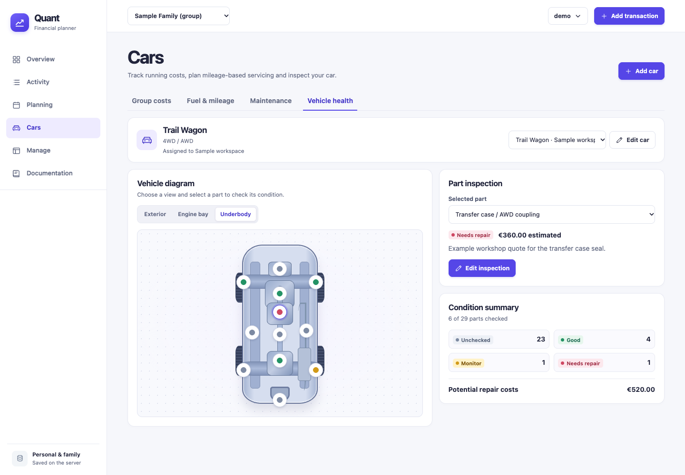

# Quant Financial Planner

Quant is a self-hosted dashboard for personal and family finances. It tracks balances and spending, forecasts cash flow and major purchases, and helps households plan vehicle running costs. The web app uses Python and SQLite, with a C++23 engine for purchase projections.

[Screenshots](#screenshots) · [Quick start](#run-the-web-dashboard) · [VM deployment](#vm-configuration) · [Vehicle costs](#track-vehicle-costs) · [Backups and restore](#backups-and-restore) · [Tests](#run-the-tests) · [Architecture](#architecture-and-design-specification)

## Screenshots

Both screenshots use fictional sample data.

### Dashboard


### Cars



## Run the web dashboard

Use Python 3.10 or later and `lsof`. To build the purchase projection engine, install CMake 3.20 or later and a C++23 toolchain with `std::expected` and `std::format` support. Run this command from the project directory.

```sh
./start.sh
```

Open the URL printed in the terminal, which defaults to [http://127.0.0.1:8080/](http://127.0.0.1:8080/). Use the one-time setup code from the terminal to create the first administrator. The script replaces an existing Quant process running from this project under your user account. Use `./start.sh 8081` to choose another port or `./start.sh 0` to pick a free one automatically.

To access Quant from devices on the server’s local network, run `./start.sh --lan` and open the address printed in the terminal. On macOS and Linux, LAN mode detects the active private IPv4 address and accepts clients on the same subnet. For a custom port, use `./start.sh --lan 8081`. The Python-only equivalent is `python3 -m apps.web --lan`.

### VM configuration

`./start.sh` reads the project’s [quant.ini](quant.ini). For a VM-specific copy, set `database` and the backup `directory` to persistent paths that the service account can write to, such as `/var/lib/quant/finance.sqlite3` and `/mnt/backups/quant`. Relative paths resolve from the configuration file. If you keep the config outside the project, use an absolute `projection_bin` path for the built engine. Set `build = false` to use a prebuilt engine or run the Python dashboard alone.

After enrolling the VM, set `[server] mode` to `tailscale` or `netbird`. Quant detects the chosen provider’s IPv4 address, listens on that address, and restricts incoming connections to the detected overlay range. Open the URL printed at startup from an allowed VPN peer. Grant access to the configured TCP port using your VPN access policy. For an HTTPS reverse proxy, use `mode = loopback` with `public_url` set to the address used by browsers.

```sh
./start.sh --config /etc/quant/quant.ini
```

For automatic startup on a Linux VM, this example assumes a service account named `quant`, the checkout at `/opt/quant`, and a configured `/etc/quant/quant.ini`. Build once as needed, then set `build = false` and give the service account write access to the data and backup directories.

```ini
[Unit]
Description=Quant Financial Planner
Wants=network-online.target
After=network-online.target

[Service]
User=quant
WorkingDirectory=/opt/quant
ExecStart=/opt/quant/start.sh --config /etc/quant/quant.ini
Restart=on-failure
RestartSec=10

[Install]
WantedBy=multi-user.target
```

Save the unit as `/etc/systemd/system/quant.service`, then run `sudo systemctl daemon-reload` and `sudo systemctl enable --now quant`. Use `journalctl -u quant -f` to see the dashboard address and backup log.

### Manual startup

```sh
cmake -S . -B build
cmake --build build
python3 -m apps.web
```

Open [the local dashboard](http://127.0.0.1:8080/). Pass `--port 0` to use an available port and open the address printed in the terminal. Pass `--projection-bin /path/to/planner_projection` if you build into a different directory. The ledger and dashboard also run with Python alone.

### Sign in and invite family

1. Enter the one-time setup code from the server terminal and create the service owner's sign-in. It opens the existing **Personal** ledger.
2. Create a personal profile for each person under **Manage → Workspaces**. Use **Manage → Family access** to create an invitation for that profile and share the link directly with its intended recipient. Links expire after 48 hours and work once.
3. Create a group such as **Family** and choose the profiles to share with the group. Each person can open their own ledger and the groups they belong to. Group members can see the balances, transactions and schedules shared by each included profile, and can record activity in joint accounts. The service owner manages group membership and can revoke invitations, sign out accounts or disable a sign-in.

After administrator setup, **Create an account** on the sign-in page gives a new user a personal workspace. The service owner can add that profile to an existing group under **Manage → Workspaces**. For a personal profile that already exists, use its invitation link.

For HTTPS access through a reverse proxy, forward requests to the loopback address on the machine running Quant. Preserve the public `Host` header, and forward the original `Origin` header when the browser sends one. Start the dashboard with the same HTTPS origin:

```sh
python3 -m apps.web --port 8080 --public-url https://finance.example.com
```

Sessions expire after seven days. Anyone can change their own password from the account menu. To recover a password from the server terminal, run `python3 -m apps.web --reset-password USERNAME` with the same `--config` or `--db` option used by the running server. The reset signs out existing sessions for that username.

### Learn with sample data

Open **Documentation** for articles and worked examples, or select **Open quick-start guide** to replay the first-run tour. The guide highlights the navigation to click and explains a tab when you reach it. Skip any step or the whole guide. Use the **Info** button on a feature to read a short explanation and jump to its article.

Under **Manage → Workspaces**, open **Sample workspace** or **Sample Family**. Quant creates a private copy of the fictional ledgers for your sign-in. Any changes you make there persist across sessions. Switch back to your personal profile when you want to work on your own finances.

### Track your finances

- **Manage → Workspaces** lists personal and group workspaces. The workspace selector switches between your personal ledger and the combined views available to you. A group can also have its own joint accounts.
- Groups combine member accounts, transaction history, scheduled cash movements, and goals. Group goals can link to member savings. Existing member goal allocations compete for the same cash in the group projection. You can record a regular transaction in your own account from a group workspace. Open your personal workspace to edit its history, manage schedules, or import statements.
- **Planning → Group limits** sets monthly expense caps for the whole group, a member, or a category. Members can see applicable limits from their own workspace. The Overview calls out actual and projected breaches, and caps use the personal share of a split payment.
- **Overview → Needs attention** links to upcoming bills, overdue planned reimbursements, import rows still in review, group spending alerts, and the projected cash low over the next 30 days. Flow map branches stay expanded across navigation and reloads within the same workspace. **Reset view** clears the expansion and **Fullscreen** opens the map at full size.

- **Overview** shows current tracked net worth and period totals. Switch between wealth, cash flow, and combined data in line, vertical bar, or stacked bar views. **Data** opens the underlying figures. The one-month view covers the last 30 days. Longer presets use calendar months, including the current partial month.
- **Accounts** tracks checking, cash, savings, and investment accounts in euros. Set an opening date and the balance immediately before the first transaction you intend to enter. As you add older records, you can move that opening date back and update the corresponding opening balance.
- **Planning → Monthly returns** schedules deposit interest and fixed-income payouts. Set a fixed euro amount or a monthly percentage on a fixed principal, then choose where the payment lands. A payout to a cash or savings account feeds the cash forecast. A payout retained in an investment account adds to its recorded balance when you post it. Record a payment or match an existing transaction to keep the ledger from counting it twice.
- **Transactions** records actual activity through today. Transfers move money between accounts. An investment contribution moves cash into an investment account. Use **Investment value change** to record increases or decreases in a portfolio's value. Account transfers and investment contributions preserve total tracked wealth.
- **Cash wallet** tracks the money you physically hold. Use **Manage → Accounts → Add cash wallet** to enter the amount you already have. On the wallet card, use **Record cash expense** for spending and **Record cash withdrawal** to move money from bank to wallet.
- **Transaction attachments** keeps invoices, receipts and other documents with a regular transaction. Use **Attach documents** while entering or editing a transaction, or click its paperclip in the ledger. Quant stores the files in the transaction's workspace database. Personal attachments open from the owning workspace. Group members can download attachments on joint entries. Each transaction can hold up to 12 files, with up to 10 MB per file.
- **Categories** supports separate trees for income, expenses, and investment contributions. During sign-in setup or workspace creation, choose whether to add starter categories. You can also add them later from Categories. Existing names and organization are preserved. **Money flow** expands each category to its recorded transactions. The line widths reflect the amounts.
- **Money flow → Replay months** lets you scrub through recorded months or pin a month for comparison. Both maps use the same scale. Select a branch to inspect it and open its transactions.
- **Insights** reconciles monthly net worth through income, expenses, investment value changes, and newly opened account balances. Select a waterfall step to see its entries. The spending detective shows the transactions that established each recurring pattern or historical baseline.
- **Shared payments** records one-time and recurring expenses with tagged people and equal or custom shares. Paying the bill reduces cash by the full amount. The spending reports count your share, and net worth also includes the balance people owe you or you owe them. Recorded reimbursements move cash and settle that balance. Schedule a reimbursement to include it in forecasts while it is pending.
- **Forecast** shows actual and projected daily cash alongside scheduled commitments. Create income, bills, subscriptions, transfers, or investment contributions. Post an occurrence or match it to a transaction you already recorded so it counts once. The what-if simulator compares reserve breaches under alternate purchase timing, recurring costs, and investment contributions, and can save the results.
- **Funding check** projects the account that pays a bill or purchase. Find it in the cash runway, the Purchase planner, or **Planning**. Set account reserves, optional availability dates for locked deposits, and approved direct transfer routes. Quant protects earmarked goal money and calculates the smallest transfer that keeps the paying account funded. It also shows the earliest feasible date if a payment should wait and a comparison with delayed reimbursements. Transfers are suggestions based on daily closing balances and Monday–Friday settlement days.
- **Goals** links each target to one or more savings accounts. Preview a monthly contribution redirect between goals that share an account. The estimated dates use up to five years of forecast cash movements in those accounts.
- **Purchase planner** compares upfront and gradual funding with the original C++ planning engine. Use ledger balances to prefill current cash and savings and the average change due to recorded activity in the last three full months. Save a comparison with optional monthly category estimates, then use **Forecast → Plan vs. actual** to compare the original projection with recorded month-end cash and category totals.
- **Decision lab** simulates daily cash from scheduled commitments and editable uncertainty about income, bills, reimbursements, and surprise expenses. Optional historical sampling draws unscheduled activity from completed months. The reverse planner calculates purchase capacity at your selected reserve success target, and the stress test and driver ranking show where the plan is vulnerable. Results depend on the modeled assumptions.
- **Decision optimizer and goal trade-off** compare purchase dates, investment contributions, and reallocations between goals. Goal dates show when each target is first funded in the forecast. The optimizer compares a finite grid of choices for review.
- **Forecast scorecard** checks saved models against later recorded cash balances using their original account scope. It shows signed and absolute errors for purchase plans, what-if baselines, and risk forecasts. Band coverage uses the 10th–90th percentile range from saved risk forecasts.
- **Import payments** accepts bank and card CSVs, PDF statements, and Amazon order exports. Map columns, review the amounts, and select which rows to post or match. You can reconcile an imported row to an existing charge, transfer, scheduled commitment, or shared settlement. PDF extraction runs locally with Poppler or macOS PDFKit. On macOS, **Read scanned pages with local OCR** uses Vision for scans.
- Leave **This transaction will appear on a statement** checked for bank expenses you record manually. **Apply ready rows** records clear rows and links verified matches to the original transaction. Ambiguous matches stay available for review. Import each bank account’s files into the corresponding ledger account. Find archived PDFs under **Original PDF statements → Download original PDF**.

### Track vehicle costs

- **Cars → Add car** lets you choose the drivetrain, select optional components, and assign the car to one or more people or groups. A shared car has one history across its assigned workspaces.
- **Fuel & mileage** records fuel volume, price, and total odometer readings. Use **Import CSV** for dated readings with `date,odometer_km` as the header and `YYYY-MM-DD` dates. Record at least two full fill-ups with any partial fills in between to measure consumption.
- **Maintenance** records repairs and general maintenance. Use **Add interval** for recurring work, such as an oil change every 20,000 km. **Log service** starts the next interval from the odometer reading on the completed service.
- **Vehicle health** has exterior, engine bay, and underbody diagrams. Select a part, mark it **Good**, **Monitor**, or **Needs repair**, and record a repair estimate if you have one.
- **Family → Cars → Group costs** combines recorded fuel, maintenance, and repair spending for the cars assigned to Family. The per-car forecast shows 12 months of fuel and scheduled services, upcoming service dates, and potential repairs based on flagged parts.

### Import PDFs with OpenAI

1. Open **Activity → Import payments**, choose **PDF statements**, then choose **AI with OpenAI**. Paste an [OpenAI API key](https://platform.openai.com/api-keys) and select **Save key**. Quant can also save the key after the first successful extraction. Use **Change key** or **Remove key** to manage it. Saved keys belong to your sign-in. Quant can use the server’s `OPENAI_API_KEY` if you have no personal key.
2. Pick the ledger account and select its statement or receipt PDFs together. Confirm that Quant may send each complete PDF to OpenAI. OpenAI reads scanned pages directly. Quant saves the originals in its own archive so you can retrieve them after extraction, including when an OpenAI request fails. [OpenAI PDF inputs](https://developers.openai.com/api/docs/guides/file-inputs)
3. Review the combined summary. Expenses over €250 appear individually with their original descriptions. Expenses of €250 or less are totaled by month. Credits appear separately. Quant keeps each transaction and its posting date in the ledger and learns category suggestions from previously categorized transactions with the same description and account.
4. **Apply ready rows** posts eligible rows and reconciles clear matches. When the statement has printed debit and credit totals, Quant compares those totals with the sum of the extracted entries. Check any incomplete totals, possible duplicates, and open issues against the PDF before applying those rows. Use **Download normalized JSON** for structured details including available page and evidence references.

An unnamed PDF import defaults to **Bill - YYYY-MM-DD**. Saved OpenAI keys are encrypted with `openai-fernet.key`. Include that private file in your workspace backup to restore saved keys.

### Import a PDF with Groq

1. Create an API key on the [Groq Free plan](https://console.groq.com/keys). Paste it into the import form and select **Save key**, or run an AI import to save it after the first successful extraction. Use **Change key** or **Remove key** in the same form. A saved key belongs to your sign-in, including when you work in a group. Quant uses the server’s `GROQ_API_KEY` only when you have no personal key.
2. Open **Activity → Import payments**, select **PDF statement**, and choose **AI with Groq**. Pick the ledger account and confirm that Quant can send the locally extracted text to Groq. The PDF file itself stays on the Quant server. You can manage Groq’s retention settings in [Data Controls](https://console.groq.com/docs/your-data).
3. Optionally name the import. The default is **Bill - YYYY-MM-DD** using the date displayed by the dashboard. Merchant descriptions in the PDF stay on their own transactions. Review the dates, signed amounts and currency, then select the rows to record or match. You can download the normalized JSON or CSV from the review screen.

Groq's Free plan has [usage limits](https://console.groq.com/docs/rate-limits). For a statement that exceeds the extraction limit, split the PDF into smaller files or use the bank’s CSV export. **Local extraction** remains available without a key.

Remembering keys requires `cryptography` on the server. If it is missing, install it with `python3 -m pip install cryptography` using the same Python interpreter that runs Quant. Quant encrypts personal keys on the server. Keep the private `groq-fernet.key` file in your workspace backup if you want to restore saved keys.

For future statement extraction tools, import UTF-8 CSV with `Date,Description,Amount,Currency,Reference` columns. Use ISO dates, negative amounts for debits, positive amounts for credits, and EUR currency. A bank-provided transaction reference helps identify duplicates. **Download normalized CSV** exports the reviewed fields in this format. For Amazon, download the retail order history from **Request My Data** and import the supported CSV or ZIP. The importer also accepts physical-order JSON from Amazon Data Portability.

### Backups and restore

Set `[backups] directory`, `interval_hours`, and `keep` in `quant.ini`. The defaults write to `backups/` every 24 hours and retain the 14 latest completed snapshots of the configured database. Quant takes the first snapshot at startup and checks for a missed backup whenever it starts. `./start.sh --config /etc/quant/quant.ini --backup-now` takes a snapshot on demand while the dashboard runs. Backup completion and errors are printed to the server log.

Each timestamped snapshot has a `ledger/` folder containing the main database, workspace databases and registry, and any saved provider encryption keys. The manifest lists the files and their SHA-256 checksums. The snapshot contains personal financial data and saved account credentials, so store it in a private directory and keep a copy on a separate disk or backup service.

To restore or move to a new VM, stop Quant at the restore destination and copy the contents of one snapshot’s `ledger/` folder into a fresh data directory. Keep the main database’s filename and its sibling `.workspaces` directory together. Set `database` in the destination configuration to the restored main file and start Quant. Provision the VM’s VPN client and environment-based secrets separately.

## Run the tests

```sh
cmake -S . -B build
cmake --build build
ctest --test-dir build --output-on-failure
```

The C++ CLI is available as `./build/financial_planner` for exercising the shared car purchase example. The optional argument sets the purchase price in whole euros.

## Architecture and design specification

## 1. Project Overview

### 1.1 Purpose

The **Financial Planner** is a C++23 application designed to help a user decide how current and future financial decisions should affect savings, expenses, liquidity, and investments.

The system is not intended to be only a bookkeeping application. Its main purpose is to reason about **financial choices over time**.

A typical question is not merely:

> Can I afford to spend €10,000?

Instead, the Planner should be able to answer questions such as:

> If I want to buy a €10,000 car in six months, what are the possible ways to finance that expense while respecting my liquidity reserve, investment strategy, risk profile, and other future goals?

The Planner may therefore propose several alternatives, for example:

- accumulate the required amount entirely as cash;
- temporarily reduce investment contributions;
- use part of existing savings;
- reserve funds in a low-risk time deposit;
- combine savings and reduced investment contributions;
- preserve investments at the cost of lower liquidity;
- preserve liquidity at the cost of lower investment exposure.

The system should evaluate the consequences of each alternative over time and present them to the user.

The user selects one of the proposed plans. Only after this choice is made can the selected plan be executed against the application's financial state.

---

## 2. Academic and Engineering Goals

The project is intended both as a useful personal application and as an academic software-engineering project suitable for a technical portfolio or curriculum.

The project should demonstrate:

1. domain-driven modelling of a non-trivial financial problem;
2. appropriate use of well-known software design patterns;
3. modern C++23 techniques;
4. static and dynamic polymorphism;
5. value-oriented design;
6. separation between planning and execution;
7. explicit modelling of time, risk, constraints, and preferences;
8. testable architecture based on dependency injection;
9. extensibility toward external financial services such as Interactive Brokers;
10. clear justification of architectural decisions and rejected alternatives.

The objective is **not** to insert as many design patterns as possible.

Patterns should be used only where the domain presents a genuine variation point or architectural problem.

A central academic principle of the project is therefore:

> Patterns should emerge from the problem rather than being forced into the implementation.

---

# 3. High-Level Functional Idea

The system receives a description of the user's current financial position and future intentions.

Examples of input include:

- current cash;
- savings accounts;
- investment positions;
- recurring income;
- recurring expenses;
- discretionary expenses;
- minimum liquidity requirements;
- future known expenses;
- goals;
- investment preferences;
- risk configuration;
- optimization preferences.

The Planner then reasons about how a proposed decision affects future financial states.

Conceptually:

```text
FinancialState(now)
        |
        v
FinancialState(t1)
        |
        v
FinancialState(t2)
        |
       ...
        |
        v
FinancialState(goal_date)
```

The financial problem is therefore intrinsically time-dependent.

A decision made today can affect:

- available cash;
- future monthly savings;
- investment contributions;
- portfolio value;
- expected investment return;
- the ability to satisfy later goals;
- the amount of money that must remain liquid;
- exposure to financial risk.

---

# 4. Core Architectural Principle

The main architecture separates four responsibilities:

```text
Planner       = proposes what could be done
Optimizer     = searches and ranks alternatives
RiskManager   = evaluates risk
Engine        = executes the selected actions
```

The authoritative financial state is kept separately:

```text
FinancialState = source of truth
```

The most important architectural invariant is:

> **Only the Engine is allowed to mutate the authoritative financial state.**

The Planner, Optimizer, and RiskManager operate on immutable snapshots.

This creates a strong separation between:

- analysis;
- recommendation;
- user decision;
- execution.

---

# 5. High-Level Architecture

```text
                           GUI
                            |
                            v
                         Planner
                            |
                  +---------+---------+
                  |                   |
                  v                   v
               Optimizer          RiskManager
                  |                   |
        +---------+---------+         |
        |                   |         |
        v                   v         v
OptimizationPolicy        Solver   RiskStrategy
                  |
                  v
            Candidate Plans
                  |
                  v
               Planner
                  |
                  v
              Ranked Plans
                  |
                  v
                 GUI
                  |
           user selects one
                  |
                  v
               Commands
                  |
                  v
                Engine
                  |
        +---------+---------+
        |                   |
        v                   v
      Broker          FinancialRepository
        |                   |
        v                   v
      Trades         FinancialState
```

---

# 6. Main Application Flow

The main application workflow is:

```text
FinancialSnapshot
        +
       Goal
        +
      Config
        |
        v
     Planner
        |
        v
 Candidate Plans
        |
        +------> RiskManager
        |
        +------> Optimizer
        |
        v
   Ranked Plans
        |
        v
       GUI
        |
   user chooses
        |
        v
     Commands
        |
        v
      Engine
        |
        v
Transactions / Trades
        |
        v
 FinancialState
```

Planning and execution are deliberately separate.

The Planner may generate plans that are never executed.

The Engine receives only the plan or commands that the user has actually accepted.

---

# 7. Domain Model

## 7.1 Value-Oriented Domain

The domain should strongly prefer explicit value types instead of primitive values such as raw `double`, `int`, or `std::string`.

Instead of:

```cpp
double money;
double risk;
int priority;
double time;
```

the project should introduce domain types such as:

```cpp
Money
Currency
Quantity
Risk
Priority
Duration
Date
Percentage
InterestRate
```

This prevents primitive obsession and allows the compiler to enforce domain rules.

---

## 7.2 Money

Money should be a strong domain type.

A possible representation is:

```cpp
enum class Currency {
    EUR,
    USD,
    GBP
};

struct Money {
    std::int64_t minor_units;
    Currency currency;
};
```

Using integer minor units avoids many floating-point issues for ordinary monetary values.

Potential operations include:

```cpp
Money + Money
Money - Money
Money * Percentage
Money / scalar
```

Operations between different currencies should either be rejected or require an explicit exchange-rate service.

---

# 8. Financial State

`FinancialState` represents the authoritative current state of the user's finances.

It may contain:

```text
FinancialState
|
+-- Cash accounts
+-- Savings accounts
+-- Deposits
+-- Investment accounts
+-- Positions
+-- Recurring incomes
+-- Recurring expenses
+-- Scheduled transactions
+-- Active goals
+-- Historical transactions
```

The exact internal structure can evolve as the implementation matures.

The central rule remains:

> Components involved in planning receive a read-only snapshot, not mutable access to the real state.

---

## 8.1 FinancialSnapshot

The Planner should use:

```cpp
FinancialSnapshot snapshot = repository.snapshot();
```

rather than direct mutable access to `FinancialState`.

The following components should receive only:

```cpp
const FinancialSnapshot&
```

where practical:

```text
Planner
Optimizer
RiskManager
Solver
Strategies
```

This allows hypothetical simulations without changing the real financial state.

---

# 9. Transactions

A transaction records a financial event that has actually occurred or has been committed to the state.

Potential transaction categories include:

```text
Income
Expense
Saving
Investment
Transfer
Interest
Fee
```

The project should avoid assuming immediately that all transaction categories require inheritance.

Possible representations include:

### Runtime inheritance

```cpp
class Transaction {
public:
    virtual ~Transaction() = default;
};
```

### Tagged template types

```cpp
template<typename Kind>
class Transaction;
```

### `std::variant`

```cpp
using Transaction = std::variant<
    IncomeTransaction,
    ExpenseTransaction,
    SavingTransaction,
    InvestmentTransaction,
    TransferTransaction
>;
```

For a closed set of transaction types, `std::variant` is likely to be a strong C++23 choice.

The final choice should be driven by the expected extension model.

---

# 10. Goals Are Not Transactions

A major modelling decision is that a financial goal should **not** be represented as a transaction.

For example:

> Buy a €10,000 car in six months.

This is not yet a financial event.

It is a future requirement.

A possible model is:

```cpp
struct Goal {
    Money target;
    Date due_date;
    Priority priority;
    Flexibility flexibility;
};
```

More specialized types may later be introduced:

```cpp
struct FutureExpense;
struct SavingsTarget;
struct WealthTarget;
struct EmergencyFundTarget;
```

The Planner converts a goal into one or more possible plans.

---

# 11. Future Expenses

A future expense represents a known or anticipated expense at a future date.

Example:

```text
Car purchase
Target amount: €10,000
Due date: 6 months
Priority: High
Flexibility: ±1 month
```

A future expense does not immediately reduce the current balance.

Instead, it constrains the planning problem.

---

# 12. Plan as a First-Class Domain Object

`Plan` is one of the most important objects in the architecture.

A Plan represents one possible way to satisfy one or more goals.

Example:

```cpp
struct Plan {
    std::vector<ScheduledCommand> commands;
    FinancialProjection projection;
    RiskAssessment risk;
    PlanScore score;
};
```

A Plan may include:

- immediate actions;
- monthly actions;
- future actions;
- investment changes;
- savings allocations;
- transfers;
- deposit creation;
- expected state evolution;
- risk metrics;
- plan score.

---

## 12.1 Example Plans

Assume:

```text
Goal:
Buy a car for €10,000 in 6 months.
```

The Planner might generate:

### Plan A

```text
Save €1,667 per month in cash.
```

### Plan B

```text
Temporarily reduce monthly investment contributions
and redirect the difference into the car fund.
```

### Plan C

```text
Allocate an existing amount into a short-term
low-risk deposit maturing near the purchase date.
```

### Plan D

```text
Use part of current savings immediately and
accumulate the remaining amount monthly.
```

### Plan E

```text
Preserve long-term investments and accept lower
short-term liquidity.
```

Each alternative represents a different trade-off.

---

# 13. Financial Projection

The Planner should not evaluate plans only based on today's balances.

Each plan should produce a projected evolution of the financial state.

Conceptually:

```text
Plan
 |
 v
FinancialProjection
 |
 +-- State at t1
 +-- State at t2
 +-- State at t3
 +-- ...
 +-- State at goal date
```

A projection might track:

```text
Cash
Savings
Investments
Expected returns
Known expenses
Goal funding
Liquidity reserve
Risk indicators
```

---

# 14. Planner

The `Planner` is the main public planning interface.

It acts as a **Facade** over the underlying planning subsystem.

A possible interface might eventually resemble:

```cpp
class Planner {
public:
    std::vector<Plan> propose(
        const FinancialSnapshot& state,
        const Goal& goal,
        const PlannerConfig& config
    ) const;
};
```

The Planner coordinates:

```text
Goal interpretation
Candidate plan generation
Constraint checking
Risk assessment
Optimization
Ranking
Projection
```

It does not execute actions.

It does not mutate the real state.

---

# 15. Facade Pattern

The `Planner` is a natural use of the **Facade Pattern**.

Without a Facade, a GUI or client might need to directly coordinate:

```text
RiskManager
Optimizer
Solver
FundingStrategy
Constraints
ProjectionEngine
```

Instead, the application can expose:

```cpp
planner.propose(...)
```

The Facade provides a simple interface over a more complex subsystem.

The academic justification is:

> The Planner hides orchestration complexity from the application layer while preserving separation between specialized internal components.

---

# 16. Strategy Pattern

Strategy is expected to be one of the central design patterns in the project.

However, there should not be one giant generic Strategy hierarchy.

Different domain questions represent independent variation axes.

Likely strategy categories include:

```text
FundingStrategy
RiskStrategy
OptimizationPolicy
ExecutionStrategy
```

---

# 17. FundingStrategy

A FundingStrategy answers:

> Where should the money required for a goal or expense come from?

Possible strategies include:

```text
PreserveInvestments
PreserveSavings
PreserveLiquidity
BalancedFunding
MinimizeOpportunityCost
```

Example:

For a €10,000 future expense:

### PreserveInvestments

Prefer:

```text
Cash
Savings
Reduced discretionary spending
```

before reducing investment exposure.

### PreserveSavings

Prefer:

```text
Reduced investment contributions
Investment liquidation
```

before using protected savings.

### PreserveLiquidity

Prefer locking or investing current funds if future cash flows can replenish liquidity safely.

---

# 18. RiskStrategy

`RiskStrategy` evaluates the risk of a proposed plan.

Examples of possible risk dimensions include:

```text
Liquidity risk
Investment volatility
Goal failure probability
Concentration risk
Time-horizon mismatch
Emergency reserve risk
```

A potential concept:

```cpp
template<typename T>
concept RiskStrategy =
    requires(
        const T& strategy,
        const FinancialSnapshot& state,
        const Plan& plan
    )
{
    {
        strategy.evaluate(state, plan)
    } -> std::same_as<RiskAssessment>;
};
```

Possible implementations:

```text
ConservativeRisk
BalancedRisk
AggressiveRisk
```

---

# 19. RiskManager

The RiskManager coordinates risk evaluation.

Conceptually:

```text
RiskManager
    |
    v
RiskStrategy
```

A possible static-polymorphism version is:

```cpp
template<RiskStrategy R>
class RiskManager {
public:
    explicit RiskManager(R strategy)
        : strategy_{std::move(strategy)} {}

    RiskAssessment evaluate(
        const FinancialSnapshot& state,
        const Plan& plan
    ) const
    {
        return strategy_.evaluate(state, plan);
    }

private:
    R strategy_;
};
```

---

# 20. Optimizer

The Optimizer determines how plans should be searched and ranked.

It should not be treated as a single monolithic algorithm.

The design should distinguish:

```text
What should be optimized?
```

from:

```text
How should the optimization problem be solved?
```

Therefore:

```text
Optimizer
 |
 +-- OptimizationPolicy
 |
 +-- Solver
```

---

# 21. OptimizationPolicy

An OptimizationPolicy defines the objective or preference structure.

Possible policies include:

```text
PreserveInvestmentsPolicy
PreserveLiquidityPolicy
BalancedPolicy
MaximumExpectedWealthPolicy
MinimizeGoalFailurePolicy
MinimizeOpportunityCostPolicy
```

The policy may define weights or ordering rules for metrics such as:

```text
Expected final wealth
Liquidity
Investment continuity
Goal probability
Risk
Cash reserve
Opportunity cost
```

---

# 22. Solver

The Solver determines how the optimization problem is searched.

Possible solver implementations include:

```text
ExactSolver
GreedySolver
HeuristicSolver
LinearProgrammingSolver
MonteCarloSolver
```

Not all solvers need to be implemented in the first version.

A key conceptual correction is:

> "Optimal" is not itself a solver type.

Optimality is defined relative to an objective function and constraints.

For example:

```text
BalancedPolicy + ExactSolver
BalancedPolicy + HeuristicSolver
PreserveInvestmentsPolicy + ExactSolver
```

are meaningful combinations.

---

# 23. Constraints, Preferences, and Risk

These concepts must remain distinct.

## Constraint

A constraint must be satisfied.

Example:

```text
Available liquid cash must never fall below €5,000.
```

If a plan violates this condition, the plan is invalid.

---

## Preference

A preference affects ranking but does not necessarily invalidate a plan.

Example:

```text
Prefer not to reduce ETF contributions.
```

A plan may violate this preference and still remain valid.

---

## Risk

Risk expresses uncertainty or exposure.

Example:

```text
There is a 30% projected probability of insufficient liquidity.
```

Therefore:

```text
Constraint = must be satisfied
Preference = influences ranking
Risk       = evaluates uncertainty
```

This distinction is central to the architecture.

---

# 24. Liquidity Reserve

The user can configure a minimum readily available amount.

For example:

```text
Minimum liquidity reserve = €5,000
```

This is normally best represented as a hard constraint:

```cpp
struct MinimumLiquidityConstraint {
    Money minimum;
};
```

A plan that leaves the user with only €3,000 liquid is invalid if the configured minimum is €5,000.

---

# 25. Fixed-Term Deposit Example

Assume:

```text
Car price:             €10,000
Purchase date:         24 months
Deposit return:        5%
Minimum cash reserve:  €5,000
Current cash:          €15,000
```

Possible plans may include:

### Option A — Cash reservation

Reserve the entire €10,000 now.

Advantages:

```text
Very low goal risk
Simple
Predictable
```

Disadvantages:

```text
High opportunity cost
Reduced liquidity
```

---

### Option B — Fixed-term deposit

Allocate an amount below €10,000 today into a fixed-term deposit expected to mature at approximately €10,000.

The exact required initial amount depends on:

```text
Interest rate
Compounding
Fees
Taxation assumptions
Deposit duration
```

Advantages:

```text
Capital assigned directly to goal
Potentially lower required initial amount
Low volatility if deposit terms are guaranteed
```

Disadvantages:

```text
Reduced liquidity
Funds may be inaccessible before maturity
```

---

### Option C — Monthly saving

Accumulate the required amount monthly.

Advantages:

```text
Preserves more current liquidity
Simple recurring behaviour
```

Disadvantages:

```text
Higher dependence on future income
Potentially higher goal failure risk
```

---

### Option D — Hybrid

Combine:

```text
Existing savings
Monthly savings
Reduced investment contributions
```

This may create a better balance between liquidity and investment continuity.

---

# 26. Command Pattern

The Planner should not directly perform actions.

Instead, accepted plans are converted into commands.

Examples:

```text
TransferCommand
BuyCommand
SellCommand
CreateDepositCommand
ScheduleSavingCommand
ChangeRecurringInvestmentCommand
```

A possible representation is:

```cpp
using Command = std::variant<
    TransferCommand,
    BuyCommand,
    SellCommand,
    CreateDepositCommand,
    ScheduleSavingCommand
>;
```

A Plan can contain:

```cpp
struct ScheduledCommand {
    Date execution_date;
    Command command;
};
```

---

# 27. Command, Order, Trade, and Transaction

These concepts must remain separate.

```text
Command
    = requested action

Order
    = instruction created for market execution

Trade
    = actual market execution result

Transaction
    = financial event recorded in the application's state
```

For example:

```text
SellCommand
     |
     v
Sell Order
     |
     v
Broker
     |
     v
1..N Trades
     |
     v
Recorded Investment Transaction
```

An order and a trade may not be one-to-one.

A single order may produce:

```text
zero trades
one trade
multiple partial fills
```

---

# 28. Investment Execution Flow

The conceptual investment flow becomes:

```text
InvestmentCommand
        |
        v
      Order
        |
        v
Broker / ExecutionStrategy
        |
        v
      Trade
        |
        v
Recorded Transaction
        |
        v
 FinancialState
```

This is more precise than simply modelling:

```text
Investment -> Order -> Trade
```

because it distinguishes intention, execution, and accounting.

---

# 29. Engine

The Engine is responsible for execution.

It should deliberately remain relatively simple.

The Engine should not decide which financial action is preferable.

That is Planner/Optimizer responsibility.

The Engine may perform:

```text
Command validation
Execution
Broker interaction
Transaction generation
Trade recording
Atomic state mutation
Persistence
Execution event emission
```

A possible conceptual interface is:

```cpp
class Engine {
public:
    ExecutionResult execute(const Command& command);
};
```

The implementation may depend on:

```text
FinancialRepository
Broker
ExecutionStrategy
EventPublisher
```

---

# 30. Engine Invariant

The strongest execution invariant is:

> The Engine is the only application component allowed to mutate the authoritative financial state.

The Planner may simulate changes against copies or snapshots, but never commit them.

This improves:

```text
Correctness
Auditability
Testing
Separation of concerns
Future persistence support
```

---

# 31. Lightweight CQRS-Like Separation

The architecture resembles a lightweight form of CQRS.

Planning/query path:

```text
FinancialSnapshot
      |
      v
Planner
      |
      v
Plans
```

Mutation path:

```text
Command
   |
   v
Engine
   |
   v
FinancialState
```

This does not require implementing a full CQRS framework.

The useful principle is simply:

> Reads and hypothetical planning are separated from authoritative state mutation.

---

# 32. Repository Pattern

Persistence should not be embedded directly in domain objects.

A repository abstraction can manage state access.

Conceptually:

```cpp
class FinancialRepository {
public:
    FinancialSnapshot snapshot() const;
    void apply(const Transaction&);
};
```

The actual interface may later evolve to support atomic groups of transactions.

Potential implementations:

```text
InMemoryFinancialRepository
JsonFinancialRepository
SQLiteFinancialRepository
```

The domain and Planner should not depend on the chosen persistence technology.

---

# 33. Adapter Pattern

Future integration with external systems such as Interactive Brokers should use an Adapter.

Internal code should operate against a domain-level broker abstraction.

Example:

```cpp
class IBroker {
public:
    virtual ~IBroker() = default;

    virtual AccountData fetch_account() = 0;
    virtual ExecutionResult execute(const Order&) = 0;
};
```

Then:

```text
IBroker
 |
 +-- PaperBroker
 |
 +-- IBKRAdapter
 |
 +-- FutureBrokerAdapter
```

The adapter translates between:

```text
Internal Order model
```

and:

```text
External broker API model
```

The internal domain should never depend directly on IBKR-specific data structures.

---

# 34. Manual Input and Future External Data

The initial application will use mostly manually entered financial data.

However, the architecture should make future data sources replaceable.

For example:

```text
AccountDataProvider
 |
 +-- ManualDataProvider
 +-- IBKRDataProvider
 +-- BankAdapter
```

The GUI and Planner should not care whether an account balance came from:

```text
Manual input
JSON
SQLite
IBKR
Bank API
```

---

# 35. Static Polymorphism

The project should prefer static polymorphism where:

```text
the set of implementations is closed;
the implementations are under project control;
runtime extension is not required.
```

C++23 concepts are a good fit.

Example:

```cpp
template<typename T>
concept RiskStrategy =
    requires(
        const T& strategy,
        const FinancialSnapshot& state,
        const Plan& plan
    )
{
    {
        strategy.evaluate(state, plan)
    } -> std::same_as<RiskAssessment>;
};
```

Benefits include:

```text
Compile-time interface checking
No mandatory virtual dispatch
Value semantics
Potential optimization
Clear generic contracts
```

---

# 36. Runtime Selection with `std::variant`

The GUI must allow the user to change strategies at runtime.

This creates an interesting problem:

```text
We want runtime selection
but we also prefer static concrete strategy types.
```

For a closed set of strategies, `std::variant` provides a strong compromise.

Example:

```cpp
using RuntimeRiskStrategy = std::variant<
    ConservativeRisk,
    BalancedRisk,
    AggressiveRisk
>;
```

Dispatch can use:

```cpp
std::visit(...)
```

This provides:

```text
Runtime selection
Value semantics
Closed strategy set
No mandatory inheritance hierarchy
```

---

# 37. Dynamic Polymorphism

Dynamic polymorphism remains appropriate at system boundaries where the implementation set is open-ended.

Examples:

```text
Broker APIs
Persistence backends
External services
Plugin-like integrations
```

For example:

```cpp
class IBroker {
public:
    virtual ~IBroker() = default;
    virtual ExecutionResult execute(const Order&) = 0;
};
```

This is appropriate because new brokers may be added without recompiling architectural assumptions about all possible broker types.

The academic project can explicitly compare:

```text
Classic virtual polymorphism
Concept-based static polymorphism
std::variant runtime dispatch
Type erasure
```

and explain why different mechanisms are chosen in different parts of the architecture.

---

# 38. Factory Pattern

Configuration selected through the GUI may need to be translated into concrete strategy or solver objects.

A Factory can isolate this creation logic.

For example:

```text
Config:
Risk profile = Balanced
Solver = Exact
Funding preference = Preserve Investments
```

can be translated into:

```text
BalancedRisk
ExactSolver
PreserveInvestmentsStrategy
```

The Planner should not contain a large switch statement for constructing every possible dependency.

---

# 39. Builder Pattern

A Builder may be useful if Planner configuration becomes complex.

Example:

```cpp
auto config =
    PlannerConfigBuilder{}
        .currency(Currency::EUR)
        .minimum_liquidity(5'000_eur)
        .risk_profile(RiskProfile::Balanced)
        .solver(SolverType::Exact)
        .funding_strategy(FundingType::PreserveInvestments)
        .build();
```

Builder should only be introduced if configuration construction genuinely becomes complex enough to justify it.

---

# 40. Observer Pattern

Observer or a similar event mechanism may be useful for GUI updates.

For example:

```text
Engine executes command
        |
        v
FinancialState changes
        |
        v
Event emitted
        |
        +--> GUI refresh
        +--> Audit log
        +--> Projection invalidation
```

The GUI should not need to poll all components constantly.

The exact implementation may use:

```text
Observer
Event bus
Signals/slots
Callbacks
```

depending on the GUI framework selected later.

---

# 41. State Pattern

The State Pattern may become relevant for order lifecycle.

Example states:

```text
Created
Validated
Submitted
PartiallyFilled
Filled
Cancelled
Rejected
Expired
```

However, classic GoF State is not automatically required.

A modern C++ implementation may instead use:

```text
enum class
std::variant
explicit state machine
```

The project can compare these approaches.

---

# 42. Singleton Should Be Avoided

The project should avoid global Singleton objects such as:

```cpp
Planner::instance();
Engine::instance();
Config::instance();
```

Reasons include:

```text
Hidden dependencies
Difficult testing
Global mutable state
Poor lifecycle control
Tight coupling
```

Prefer explicit dependency injection:

```cpp
Planner{
    optimizer,
    risk_manager,
    configuration
};
```

---

# 43. Configuration

Configuration may include several independent categories.

```text
PlannerConfig
|
+-- Base settings
|   +-- Currency
|   +-- Time horizon
|
+-- Constraints
|   +-- Minimum liquidity
|   +-- Maximum allocation limits
|
+-- Strategies
|   +-- Funding strategy
|   +-- Risk strategy
|   +-- Optimization policy
|
+-- Solver
|
+-- Execution settings
```

This should remain distinct from mutable financial state.

---

# 44. Proposed Module Structure

```text
DOMAIN
|
+-- Money
+-- Currency
+-- Account
+-- Asset
+-- Position
+-- Income
+-- Expense
+-- Saving
+-- Transaction
+-- Order
+-- Trade
+-- Goal
+-- FutureExpense
+-- FinancialState
+-- FinancialSnapshot
+-- FinancialProjection

PLANNING
|
+-- Planner
+-- Plan
+-- ScheduledCommand
+-- FundingStrategy
+-- RiskManager
|   +-- RiskStrategy
|
+-- Optimizer
    +-- OptimizationPolicy
    +-- Solver

EXECUTION
|
+-- Engine
+-- Command
+-- ExecutionStrategy
+-- ExecutionResult

INFRASTRUCTURE
|
+-- FinancialRepository
+-- Broker
|   +-- PaperBroker
|   +-- IBKRAdapter
|
+-- Persistence
+-- Serialization

CONFIGURATION
|
+-- PlannerConfig
+-- Constraints
+-- Preferences
+-- ComponentFactory

APPLICATION / UI
|
+-- GUI
+-- Controllers / ViewModels
+-- User interaction
```

---

# 45. Suggested C++ Project Layout

A possible repository structure is:

```text
financial-planner/
|
+-- CMakeLists.txt
+-- README.md
+-- docs/
|   +-- architecture.md
|   +-- design-patterns.md
|   +-- domain-model.md
|   +-- decisions/
|
+-- include/
|   +-- planner/
|       +-- domain/
|       +-- planning/
|       +-- execution/
|       +-- infrastructure/
|       +-- configuration/
|
+-- src/
|   +-- domain/
|   +-- planning/
|   +-- execution/
|   +-- infrastructure/
|   +-- configuration/
|
+-- tests/
|   +-- unit/
|   +-- integration/
|   +-- scenarios/
|
+-- apps/
|   +-- cli/
|   +-- gui/
|
+-- examples/
|
+-- external/
```

The final structure should remain pragmatic rather than excessively layered.

---

# 46. Testing Strategy

The architecture should be designed for deterministic testing.

## 46.1 Domain Unit Tests

Examples:

```text
Money arithmetic
Currency mismatch
Priority ordering
Goal validation
Interest calculations
Date calculations
```

---

## 46.2 Strategy Tests

Each Strategy should be testable independently.

For example:

```text
PreserveInvestmentsStrategy
```

should be tested to confirm that it prefers available savings before reducing investment exposure under the relevant conditions.

---

## 46.3 Solver Tests

A Solver should be tested against known optimization cases.

For small problem instances, expected exact solutions can be manually calculated.

---

## 46.4 Planner Scenario Tests

Scenario tests are especially important.

Example:

```text
Current cash: €15,000
Minimum reserve: €5,000
Monthly income: €4,000
Monthly expenses: €2,500
Car goal: €10,000 in 6 months
```

Expected behaviour:

```text
Planner generates multiple valid alternatives.
No valid plan violates the €5,000 minimum reserve.
Plans differ according to configured preferences.
```

---

## 46.5 Engine Tests

The Engine should be tested for:

```text
Correct command validation
State mutation
Transaction creation
Atomic execution
Failure rollback
Broker errors
Partial fills
```

---

## 46.6 Mock External Services

External broker APIs should be replaceable by mocks or fake implementations.

For example:

```text
FakeBroker
PaperBroker
```

This allows deterministic tests without network access or real accounts.

---

# 47. Important Integration Scenario

One of the principal end-to-end scenarios should be the future-car example.

Input:

```text
Current cash
Current investments
Recurring income
Recurring expenses
Minimum liquidity reserve
Car cost
Car purchase date
Risk preference
Optimization preference
Available deposit rates
```

Processing:

```text
Generate candidate funding approaches
Project future states
Reject constraint violations
Evaluate risk
Optimize/rank alternatives
Present alternatives
```

Execution:

```text
User selects plan
Planner produces commands
Engine executes commands
Financial state is updated
```

This scenario exercises almost every major subsystem.

---

# 48. GUI Considerations

The GUI should allow runtime configuration of:

```text
Risk strategy
Funding strategy
Optimization preference
Solver
Liquidity reserve
Goals
Expected future expenses
Income
Expenses
Investment assumptions
```

Because many strategy selections occur at runtime, the architecture should allow runtime configuration without forcing all internal strategy implementations to use inheritance.

This is one reason `std::variant` is particularly relevant.

---

# 49. Possible GUI Workflow

```text
1. User enters financial state
2. User configures constraints
3. User configures strategy preferences
4. User creates a goal
5. Planner generates plans
6. GUI displays alternatives
7. User compares:
   - projected wealth
   - liquidity
   - risk
   - goal probability
   - impact on investments
8. User selects plan
9. Commands are generated
10. Engine executes
11. GUI refreshes state
```

---

# 50. Future IBKR Integration

Interactive Brokers integration should initially be treated as infrastructure, not domain logic.

Potential future capabilities include:

```text
Fetch investment positions
Fetch balances
Fetch market prices
Submit orders
Monitor order status
Record trades
```

The domain should continue to operate on its own types.

Example translation:

```text
Domain BuyOrder
      |
      v
IBKRAdapter
      |
      v
IBKR-specific request
```

and:

```text
IBKR execution response
      |
      v
IBKRAdapter
      |
      v
Domain Trade
```

This prevents external APIs from contaminating the core model.

---

# 51. Design Pattern Summary

| Pattern / Technique | Intended Role |
|---|---|
| Strategy | Risk, funding, optimization preference, execution |
| Command | Represent actions selected for execution |
| Facade | Planner public API |
| Adapter | IBKR and future external integrations |
| Repository | State persistence abstraction |
| Factory | Convert configuration into concrete components |
| Builder | Construct complex configuration if needed |
| Observer | GUI/state notifications |
| State | Potential order lifecycle modelling |
| Concepts | Static polymorphism |
| `std::variant` | Runtime choice among closed alternatives |
| Dependency Injection | Explicit component composition |

The core patterns for the academic discussion should likely be:

```text
Strategy
Command
Facade
Adapter
Repository
```

Supporting patterns can be introduced where justified.

---

# 52. Architectural Decisions to Highlight Academically

## 52.1 Planning and Execution Are Separate

The Planner never directly changes money.

This improves safety and testability.

---

## 52.2 Goals Are Requirements, Not Transactions

A goal expresses a desired future state.

A transaction records an actual financial event.

---

## 52.3 Plans Are Explicit Objects

The system does not immediately collapse reasoning into a single answer.

It retains alternative plans as inspectable domain objects.

---

## 52.4 Constraints and Preferences Are Different

Hard financial rules should not be represented merely as scoring penalties.

---

## 52.5 Optimization Objective and Solver Are Different

The question:

```text
What does the user prefer?
```

is distinct from:

```text
Which algorithm searches the solution space?
```

---

## 52.6 Static and Dynamic Polymorphism Coexist

Static polymorphism is preferred for closed internal policy sets.

Dynamic polymorphism is acceptable at open external boundaries.

---

## 52.7 External Systems Are Adapted

The core domain should remain independent of IBKR, databases, or GUI frameworks.

---

# 53. Potential C++23 Features

The project may make meaningful use of:

```text
Concepts
std::variant
std::visit
std::expected
std::chrono
Ranges
Strong value types
constexpr where appropriate
Designated initializers
Structured bindings
Three-way comparison
Modules, if toolchain support is satisfactory
```

---

# 54. `std::expected`

C++23 `std::expected` can be useful for operations that may fail without using exceptions for ordinary domain errors.

Examples:

```cpp
std::expected<ExecutionResult, ExecutionError>
execute(const Command&);
```

or:

```cpp
std::expected<Money, CurrencyError>
convert(...);
```

Potential errors include:

```text
Insufficient funds
Constraint violation
Invalid date
Unsupported currency
Broker rejection
Persistence failure
```

---

# 55. Domain Errors Versus Programming Errors

The project should distinguish:

```text
Expected domain failure
```

from:

```text
Programming invariant violation
```

For example:

```text
Insufficient funds
```

is a normal domain error.

An impossible internal state caused by a bug may justify an assertion or stronger failure mechanism.

---

# 56. Auditability

Because financial state changes are important, executions should ideally be auditable.

An Engine execution may produce:

```text
Command ID
Timestamp
Command
Result
Generated transactions
Generated trades
Previous state reference
New state reference
```

This can support:

```text
Debugging
Testing
History
Undo-like future features
Reproducibility
```

---

# 57. Future Event-Sourcing Possibility

The project does not initially need full event sourcing.

However, the distinction between:

```text
Command
Transaction
FinancialState
```

makes future event-oriented persistence possible.

A later architecture could rebuild state from recorded financial events.

This is a possible extension, not an initial requirement.

---

# 58. Non-Goals for the First Version

The initial version should avoid unnecessary complexity.

Likely non-goals include:

```text
Real-money automatic trading
High-frequency trading
Tax optimization
Multi-user cloud synchronization
Distributed systems
Machine learning
Cryptocurrency integration
Full event sourcing
Microservices
Plugin architecture
```

These can be reconsidered only if the project develops a genuine need.

---

# 59. Development Roadmap

## Phase 1 — Domain Foundation

Implement:

```text
Money
Currency
Date/time utilities
Account
FinancialState
FinancialSnapshot
Transaction
Goal
FutureExpense
```

Focus on correctness and value semantics.

---

## Phase 2 — Basic Planning

Implement:

```text
Plan
FinancialProjection
Simple constraints
Minimum liquidity reserve
Basic funding strategies
```

Start with deterministic scenarios.

---

## Phase 3 — Optimization

Implement:

```text
Optimizer
OptimizationPolicy
Simple Solver
Plan scoring
```

Begin with a simple exact or brute-force solver for small search spaces if useful.

---

## Phase 4 — Risk

Implement:

```text
RiskAssessment
RiskManager
RiskStrategy
```

Initially use deterministic risk rules before introducing more sophisticated probability models.

---

## Phase 5 — Command and Engine

Implement:

```text
Command
ScheduledCommand
Engine
Transaction generation
FinancialRepository
```

Make Engine the only mutation path.

---

## Phase 6 — Investments

Implement:

```text
Asset
Position
Order
Trade
PaperBroker
ExecutionStrategy
```

Use a virtual paper broker before connecting to any external API.

---

## Phase 7 — GUI

Expose:

```text
State editing
Goal creation
Configuration
Plan comparison
Plan selection
Execution
```

---

## Phase 8 — External Adapter

Implement:

```text
IBroker
IBKRAdapter
```

Initially support read-only functionality before considering order submission.

---

# 60. Documentation Strategy

The project should include documentation beyond code comments.

Recommended documents:

```text
README.md
architecture.md
domain-model.md
design-patterns.md
testing.md
```

For significant decisions, Architecture Decision Records can be useful.

Example:

```text
docs/decisions/001-goals-are-not-transactions.md
docs/decisions/002-engine-exclusive-state-mutation.md
docs/decisions/003-variant-for-runtime-strategies.md
```

---

# 61. CV / Portfolio Value

The project can demonstrate more than simple implementation ability.

A strong project description could emphasize:

> Designed and implemented a modern C++23 financial-planning engine using value-oriented domain modelling, Strategy, Command, Facade, Adapter, and Repository patterns. The system separates hypothetical planning from authoritative execution, supports configurable optimization and risk policies, uses concepts and `std::variant` for static/value-based polymorphism, and is structured for future integration with external broker APIs.

The strongest technical discussion points for interviews include:

```text
Why Goals are not Transactions
Why Planner cannot mutate state
Why Strategy is split into independent policy families
Why optimization objective and solver are separate
Why std::variant is used for closed runtime choices
Why virtual interfaces are retained at external boundaries
Why Command, Order, Trade, and Transaction are separate
Why constraints are distinct from preferences
```

---

# 62. Central Architecture Summary

The final conceptual model is:

```text
                           GUI
                            |
                            v
                         Planner
                            |
              +-------------+-------------+
              |                           |
              v                           v
          Optimizer                   RiskManager
              |                           |
       +------+-------+                   |
       |              |                   |
       v              v                   v
OptimizationPolicy   Solver           RiskStrategy
              |
              v
        Candidate Plans
              |
              v
         Ranked Plans
              |
              v
             GUI
              |
      user selects one
              |
              v
           Commands
              |
              v
            Engine
              |
      +-------+--------+
      |                |
      v                v
    Broker       FinancialRepository
      |                |
      v                v
    Trades       FinancialState
```

The most important conceptual sentence is:

> **The Planner decides what could be done, the Optimizer decides which alternatives are preferable, the RiskManager evaluates whether they are acceptable, the user chooses, and the Engine executes. Only the Engine changes the real financial state.**

---

# 63. Current Open Design Questions

The architecture is intentionally not frozen yet.

The following topics should be decided during implementation:

1. whether Transactions use `std::variant`, templates, or inheritance;
2. whether Goals should form one general type or several specialized types;
3. how FinancialProjection should represent uncertainty;
4. how Plan scoring should be expressed;
5. which first Solver should be implemented;
6. which risk metrics belong in the first version;
7. whether FundingStrategy generates candidates or only ranks funding sources;
8. how recurring commands are represented;
9. how atomic multi-command execution should work;
10. how to organize additional projections in the browser dashboard;
11. how the SQLite ledger should evolve as the domain grows;
12. when IBKR integration should move from read-only to execution support.

These questions should be resolved through use cases and tests rather than by attempting to finalize every abstraction in advance.

---

# 64. Guiding Principles

The project should follow these principles:

```text
Model the domain before choosing patterns.

Use patterns where variation or coupling genuinely requires them.

Prefer value semantics.

Prefer static polymorphism for closed internal strategy sets.

Use runtime polymorphism at open system boundaries.

Keep external APIs outside the core domain.

Separate planning from execution.

Keep authoritative mutation centralized in the Engine.

Treat goals as future requirements.

Treat plans as explicit alternatives.

Distinguish constraints, preferences, and risk.

Make important architectural decisions testable.

Avoid premature generalization.
```

These principles should guide future design decisions as the Financial Planner evolves.
