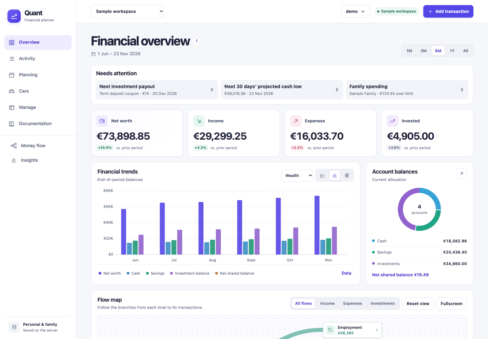

# Quant Financial Planner

Quant is a self-hosted dashboard for personal and family finances.

[Quick start](#quick-start) · [Screenshots](#screenshots) · [Documentation](#documentation)

## Quick start

You'll need Python 3.10+ and `lsof`. The default build also uses CMake 3.20+ and a C++23 compiler.

```sh
./start.sh
```

Open the address printed in the terminal, usually [http://127.0.0.1:8080/](http://127.0.0.1:8080/), and use the setup code to create your first account. To try Quant with fictional data, select **Manage → Workspaces → Sample workspace**.

## What you can do

- Track accounts, transactions, and spending. Import bank statements and attach receipts.
- Share expenses with family, set budgets, and keep track of reimbursements.
- Forecast cash flow, plan savings goals, and compare ways to pay for a large purchase.
- Log fuel, mileage, maintenance, and repairs. See upcoming car expenses for the whole family.

## Screenshots

Both screenshots use fictional sample data.

### Dashboard



### Cars


## Documentation

- [User guide](docs/user-guide.md) covers accounts, groups, imports, and vehicle costs.
- [Deployment and backups](docs/deployment.md) covers LAN access, Tailscale, NetBird, restoring data, and running tests.
- [Architecture](docs/architecture.md) covers the financial model, design patterns, and roadmap.
